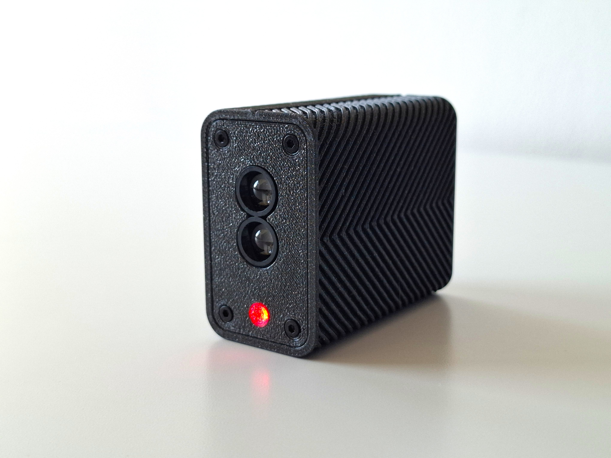
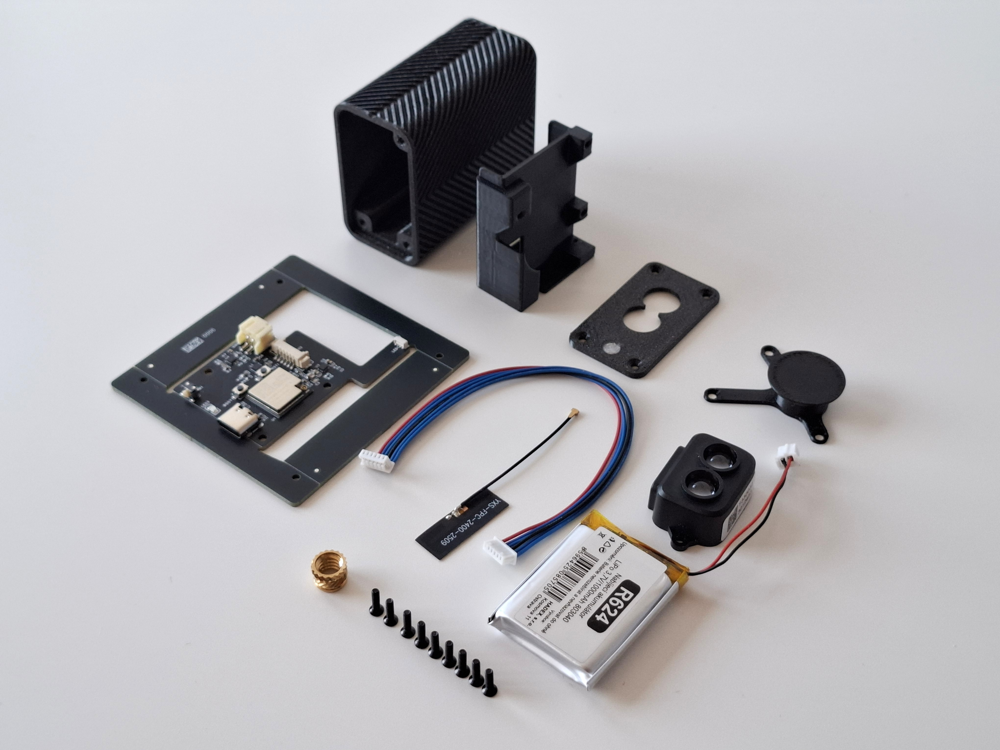
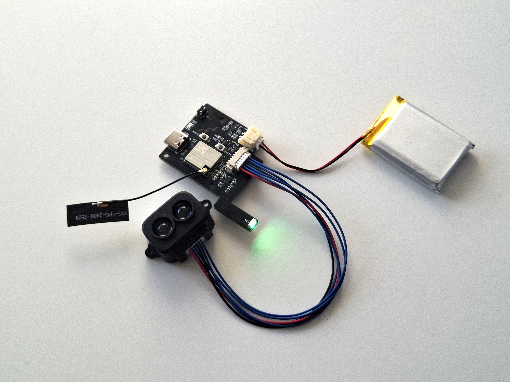

# ⚡ Laser Sprint – ESP32-C3 & TF-Luna LiDAR Timing Gate

**Laser Sprint** is an open-source, ultra-low latency wireless photogate timing system designed for track & field, agility testing, and speed profiling. Powered by an ESP32-C3 microcontroller and a TF-Luna Time-of-Flight (ToF) LiDAR sensor, it calculates instant split times and transmits data directly to Garmin smartwatches via Bluetooth Low Energy (BLE).

---

## 🌟 Key Features
- **Garmin Smartwatch Integration:** Direct real-time split times and velocity tracking on your wrist without needing a smartphone.
- **High-Frequency ToF LiDAR Sampling:** Uses TF-Luna LiDAR at 100 Hz with adaptive baseline distance evaluation for sub-millisecond trigger precision.
- **Custom BLE Protocol (`LS_GATE`):** Dynamic 128-bit UUID broadcasting time offset, gate ID, and battery levels.
- **Smart Power Management:** Deep Sleep mode with 2-second hold button wake-up/shutdown and automated 5V power gating.
- **LiPo & USB-C Powered:** Onboard battery level monitoring via ADC with NeoPixel LED status feedback.

---

## 🛠️ Hardware Specification & Pinout

The custom PCB uses the **ESP32-C3** module with the following pin assignments:

| Function | ESP32-C3 Pin | Description |
| :--- | :--- | :--- |
| **TF-Luna RX** | GPIO 5 | UART receive line (115200 baud) |
| **TF-Luna TX** | GPIO 4 | UART transmit line |
| **NeoPixel LED** | GPIO 0 | WS2812B RGB status indicator |
| **Power Button** | GPIO 1 | Input with internal pull-up & deep sleep wake-up |
| **Battery ADC** | GPIO 3 | Voltage divider input for LiPo level detection |
| **5V Power Gate** | GPIO 6 | High-side power control for peripheral rail |

> Manufacturing files (Gerber files, PCBWay project link) are available in the `/hardware` folder.

---

## 🚀 Getting Started

## 🛠️ Hardware & Assembly

### 1. Custom PCB (No Soldering Required!)
The easiest way to build the timing gate is to order the PCB directly via PCBWay with assembly service:
👉 **[Order Laser Sprint PCB on PCBWay](https://www.pcbway.com/project/shareproject/Laser_Sprint_5ba1c15b.html)**

> 💡 **Zero Soldering Option:** If you select **PCB + Assembly** during checkout, all surface-mount components (ESP32-C3, power management, charging circuit, status LED, connectors) will come pre-soldered.

---

### 2. Required Components (Bill of Materials)

To complete the assembly, you only need to plug in the following off-the-shelf hardware components:

| Component | Description / Specification | Direct Purchase Link |
| :--- | :--- | :--- |
| **Custom PCB** | Pre-assembled Laser Sprint board | [PCBWay Project](https://www.pcbway.com/project/shareproject/Laser_Sprint_5ba1c15b.html) |
| **LiDAR Sensor** | TF-Luna ToF LiDAR 8m (UART) | [Botland.cz](https://botland.cz/senzory-doby-letu/16638-laserovy-snimac-vzdalenosti-lidar-tf-luna-8-m-uart-i2c-5903351249041.html) |
| **LiPo Battery** | 3.7V 1000mAh (Size 803040 / ~40x30mm) | [Hadex.cz](https://www.hadex.cz/r624-akumulator-lipo-37v1000mah-803040-nabijeci-baterie-li-pol/) |
| **BLE Antenna** | 2.4GHz 3dBi with IPEX3 connector | [Laskakit.cz](https://www.laskakit.cz/wifi-25x9mm-antena-2-4g-3db-5cm-ipex3-konektor/) |
| **Tripod Mount** | 1/4"-20 UNC Threaded Brass Insert (Short) | [3DJake.cz](https://www.3djake.cz/cnc-kitchen/zavitova-vlozka-1-4-20-kratka-unc) |
| **Enclosure Screws** | M2x8mm Screws for 3D Printed Case | [AliExpress](https://www.aliexpress.com/item/4001199728978.html) |

---

### 3. 3D Printed Enclosure
The custom housing designed specifically for this board and component layout with a tripod mount is available on MakerWorld:
👉 **[Download 3D Enclosure on MakerWorld](https://makerworld.com/)** *(Link coming soon)*

---

### 4. Board Assembly & Firmware Flashing

Before fitting the board into the enclosure, connect the modular peripherals and flash the ESP32-C3 firmware:

1. **Connect Peripherals:**
   - Plug the **TF-Luna LiDAR sensor** into the dedicated 4-pin UART header on the PCB.
   - Attach the **2.4GHz antenna** to the IPEX3 connector on the ESP32-C3 module.
   - Connect the **3.7V 1000mAh LiPo battery** to the JST battery header.
2. **Flash the Firmware:**
   - Connect the PCB to your computer using a USB-C cable.
   - Open [`/firmware/V2_1_4.ino`](firmware/V2_1_4.ino) in **Arduino IDE** or **PlatformIO**.
   - Select Board: **ESP32C3 Dev Module**.
   - Ensure the `Adafruit_NeoPixel` library is installed and upload the code.
   - *Test power-on, LiDAR response, and NeoPixel LED feedback before closing up.*

---

### 2. 3D Enclosure Assembly

Once the board is programmed and tested, assemble it into the 3D-printed housing:

1. **Prepare the Enclosure:**
   - Download the STL files from **MakerWorld** *(link coming soon)* and print the enclosure.
   - Heat-set the **1/4"-20 threaded brass insert** into the bottom tripod hole using a soldering iron or insert tool.
2. **Final Housing Installation:**
   - Mount the **TF-Luna LiDAR** into the front window bracket facing outward.
   - Place the **LiPo battery** and **PCB** inside the main compartment.
   - Position the **IPEX antenna** cleanly along the internal enclosure wall to avoid RF interference.
   - Snap or screw the top lid closed to complete your timing gate.

---

## 📡 BLE Protocol (`LS_GATE`)

The timing gate broadcasts its status using custom Service UUIDs structured as follows:
`11111111-2222-3333-4444-555555[GateID][Active][OffsetTens][BatDigit]`

- **Gate ID:** Derived automatically from the last byte of the ESP32 MAC address.
- **Active State:** `1` when a trigger event is detected, `0` when idle.
- **Offset Tens:** Time elapsed since trigger detection (0–99 tens of milliseconds).
- **Bat Digit:** Battery level digitized from `0` (empty) to `9` (full).

---

## ⌚ Garmin App Compatibility
Download the companion **Laser Sprint** application on the Garmin Connect IQ Store to view real-time split times and velocity measurements on your wrist:

👉 **[Download Laser Sprint on Garmin Connect IQ](https://apps.garmin.com/cs-CZ/apps/ab0dfc72-5814-4e4e-b6ab-1b04906cfc66)**
---

## 📄 License
This project is licensed under the **CC BY-NC-SA 4.0** (Creative Commons Attribution-NonCommercial-ShareAlike).
